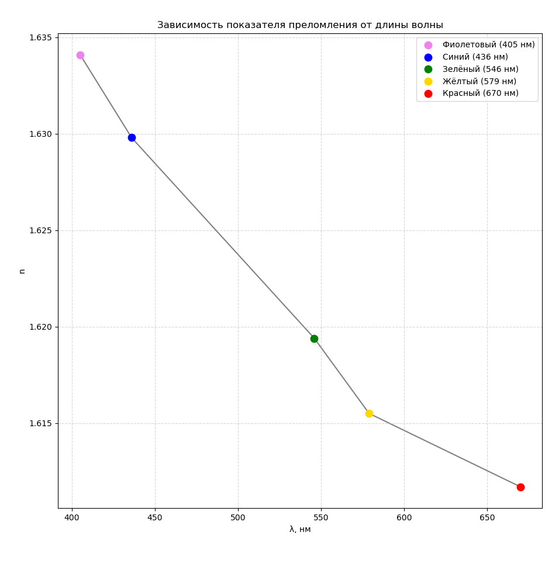

\begin{titlepage}

\begin{center}

\textbf{МИНИСТЕРСТВО ОБРАЗОВАНИЯ И НАУКИ РОССИЙСКОЙ ФЕДЕРАЦИИ}

Федеральное государственное автономное образовательное учреждение высшего образования

\textbf{«НАЦИОНАЛЬНЫЙ ИССЛЕДОВАТЕЛЬСКИЙ ТОМСКИЙ ПОЛИТЕХНИЧЕСКИЙ УНИВЕРСИТЕТ»}
\end{center}

Инженерная школа информационных технологий и робототехники

03.03.02 «Физика»

\vspace*{5cm}

\begin{center}

\textbf{ИССЛЕДОВАНИЕ ЯВЛЕНИЯ ДИСПЕРСИИ}

ЛАБОРАТОРНАЯ РАБОТА № 3-02

по дисциплине:

\textbf{Физика 3.8}

\end{center}

\vspace*{3cm}

\begin{tabular}{l l l}
Выполнил: \\ 
Cтудент группы 8к43 & Андреев Егор & 16.04.2026 \\
Проверил: \\
Ассистент отделения экспериментальной физики (ИЯТШ): &  Калинич Иван \\
\end{tabular}

\vspace*{\fill}

\begin{center}
Томск – 2026
\end{center}

\end{titlepage}

**Цель работы:** сформулировать гипотезу исследования, выделить уровни сложности изучаемой системы, исследовать явление дисперсии света с помощью дисперсионной призмы.
**Приборы и принадлежности:** источник света (ртутная лампа), гониометр Г5, дисперсионная призма.

## Краткое теоретическое введение

Дисперсия света в прозрачных материалах играет ключевую роль при расчете элементов спектральных приборов, ахроматичности линз, призм и оценке хроматической аберрации. В спектральных приборах – монохроматорах, спектрографах, спектрофотометрах и др. – в качестве диспергирующих элементов используются спектральные призмы, действие которых основано на преломлении и дисперсии света.

Явление дисперсии света заключается в зависимости показателя преломления вещества от длины волны падающего света. Первые экспериментальные исследования этой зависимости были проведены И. Ньютоном в 1672 году, который пропустил пучок белого света через призму и наблюдал спектр.

#### **Классическая теория дисперсии**

Согласно классической теории дисперсии, разработанной на основе электромагнитной теории света и электронной теории вещества, явление дисперсии объясняется взаимодействием световых волн с электронами атомов среды. Движение электронов в атоме подчиняется законам квантовой механики, однако для качественного понимания оптических явлений можно ограничиться гипотезой о существовании в атомах вещества электронов, совершающих гармонические колебания под действием квазиупругих сил.

Падающая световая волна вызывает вынужденные колебания электронов со своей частотой  $\omega$ . Электроны, будучи выведенными из положения равновесия, колеблются, постепенно теряя энергию на излучение электромагнитных волн. Таким образом, каждая частица излучает вторичные волны, которые, складываясь с первичной, образуют результирующую волну с амплитудой и частотой, отличной от первичной. Это приводит к изменению скорости световой волны  v  в среде:

\begin{equation}
v = \frac{\omega}{k},  
\end{equation}

где  k  – волновое число. Абсолютный показатель преломления вещества  n  связан со скоростью света в среде соотношением:

\begin{equation}
n = \frac{c}{v},  
\end{equation}

где  c  – скорость света в вакууме.

Таким образом, световые волны с разной частотой  $\omega$  (или длиной волны  $\lambda = \frac{2\pi c}{\omega}$ ) имеют в среде разные скорости  v , и показатель преломления  n  зависит от длины волны падающего монохроматического света. Белый свет разлагается в спектр. Зависимость показателя преломления от длины волны можно описать функцией:

\begin{equation}
n = f(\lambda_0),  
\end{equation}

#### **Нормальная и аномальная дисперсия**

Если вещество поглощает часть лучей, то в областях частот, соответствующих полосам интенсивного поглощения, наблюдается **аномальная дисперсия**. Для нормальной дисперсии

\begin{equation}
\frac{dn}{d\lambda_0} < 0.  
\end{equation}

Нормальная дисперсия лежит в основе действия призменных спектрографов и спектроскопов, так как свет разных длин волн отклоняется призмой на разные углы, образуя спектр.

Качество спектра определяется:

- **Угловой дисперсией  D**  – угловым расстоянием между двумя спектральными линиями, отличающимися по длине волны на 1 Å:

\begin{equation}
D = \frac{d\varphi}{d\lambda},  
\end{equation}

где  $d\varphi$  – угловое расстояние между спектральными линиями, отличающимися по длине волны на  $d\lambda$.

- **Разрешающей способностью  R**  – способностью призмы разделять близкие спектральные линии  $\lambda_1$  и  $\lambda_2$ . За меру разрешающей способности принимается величина:

\begin{equation}
R = \frac{\lambda}{d\lambda},  
\end{equation}

где  d\lambda  – наименьшая разность длин волн двух ещё видимых раздельно линий;  $\lambda$  – длина волны спектральной линии, вблизи которой производятся измерения. Величина  d\lambda  определяется по критерию Релея: две близкие спектральные линии считаются разрешенными, если максимум одной из них совпадает с минимумом другой.

Исследование дисперсионных призм проводят путем определения показателя преломления для различных длин волн по измерению углов отклонения световых лучей призмой. **Угол отклонения  $\delta$**  – это угол между направлением падающего на призму луча и направлением луча, вышедшего из призмы. Он зависит от угла падения  i , преломляющего угла призмы  \alpha  и показателя преломления  n  вещества призмы.

Наиболее удобно наблюдать дисперсионный спектр и делать измерения для призмы, установленной вблизи угла наименьшего отклонения  $\delta_{\text{min}}$  в параллельных лучах света. Угол  $\delta_{\text{min}}$  функционально связан с показателем преломления  n  вещества призмы и различен для разных длин волн.

Показатель преломления вещества призмы определяется по формуле:

\begin{equation}
n = \frac{\sin\left(\frac{\delta_{\text{min}} + \alpha}{2}\right)}{\sin\left(\frac{\alpha}{2}\right)}.  
\end{equation}

Для определения угловой дисперсии  D  призмы дифференцируют выражение для  n  по  $\lambda$:

\begin{equation}
\frac{d\varphi}{d\lambda} = \frac{2 \sin\left(\frac{\alpha}{2}\right)}{\sqrt{1 - n^2 \sin^2\left(\frac{\alpha}{2}\right)}} \cdot \frac{dn}{d\lambda}.  
\end{equation}

Если преломляющий угол призмы  $\alpha = 60^\circ$ , то:

\begin{equation}
\frac{d\varphi}{d\lambda} = \frac{1}{\sqrt{1 - \left(\frac{n}{2}\right)^2}} \cdot \frac{dn}{d\lambda}.  
\end{equation}

Разрешающая способность призмы  R  определяется выражением:

\begin{equation}
R = l \cdot \frac{dn}{d\lambda},  
\end{equation}

где  l  – основание призмы.

Используя зависимость  $n = f(\lambda_0)$, можно определить показатель преломления вещества призмы для различных длин волн. Сравнение экспериментальных данных с теоретическими моделями позволяет изучать оптические свойства материалов и совершенствовать конструкции спектральных приборов.

## Ход работы

### Таблица 1 – Измерение преломляющего угла призмы

\begin{tabularx}{\textwidth}{|c|X|X|X|X|X|X|}
\hline
№ опыта & Положение трубы $\varphi_1$ & Положение трубы $\varphi_2$ & $\beta$ & $\beta_{\text{ср}}$ & $\alpha$ \\
\hline
 1 & 74°25′ & 200°5′ & 125°40′ & \multirow{3}{*}{125°39′20″} & \multirow{3}{*}{62°49′40″} \\
\cline{1-4}
 2 & 74°26′ & 200°5′ & 125°39′ &                             &                            \\
\cline{1-4}
 3 & 74°26′ & 200°5′ & 125°39′ &                             &                            \\
\hline
\end{tabularx}

$$
\beta_{\text{ср}} = 125°39′20″
$$

$$
\alpha = \beta_{\text{ср}} / 2 = 62°49′40″
$$

### Таблица 2 – Измерение угла наименьшего отклонения для спектральных линий

$$
\varphi_{0\text{ср}} = 141°24′44″
$$

\setlength{\tabcolsep}{3pt}
\begin{tabularx}{\textwidth}{|c|X|c|X|c|c|X|X|X|}
\hline
\makecell{Рабочая \\ грань} & $\varphi_{0\text{ср}}$ & \makecell{Цвет \\ линии} & $\lambda$, нм & № опыта & \makecell{Положение \\ трубы} & $\varphi_i$ & $\varphi_{i\text{ср}}$ & $\delta_{\min}$ \\
\hline
Правая & & Красный       & 670 & 1  & & 89°30′  & 51°54′44″ & 51°28′30″ \\
\hline
Левая  & & Красный       & 670 & 2  & & 192°27′ & 51°2′16″  & 51°28′30″ \\
\hline
Правая & & Жёлтый 1      & 579 & 3  & & 89°14′  & 52°10′44″ & 51°56′0″  \\
\hline
Левая  & & Жёлтый 1      & 579 & 4  & & 193°6′  & 51°41′16″ & 51°56′0″  \\
\hline
Правая & & Жёлтый 2      & 577 & 5  & & 89°18′  & 52°6′44″  & 51°54′30″ \\
\hline
Левая  & & Жёлтый 2      & 577 & 6  & & 193°7′  & 51°42′16″ & 51°54′30″ \\
\hline
Правая & & Зелёный       & 546 & 7  & & 88°18′  & 53°6′44″  & 52°29′30″ \\
\hline
Левая  & & Зелёный       & 546 & 8  & & 193°17′ & 51°52′16″ & 52°29′30″ \\
\hline
Правая & & Тёмно-зелёный & 538 & 9  & & 88°18′  & 53°6′44″  & 52°40′0″  \\
\hline
Левая  & & Тёмно-зелёный & 538 & 10 & & 193°38′ & 52°13′16″ & 52°40′0″  \\
\hline
Правая & & Голубой       & 436 & 11 & & 87°35′  & 53°49′44″ & 53°20′30″ \\
\hline
Левая  & & Голубой       & 436 & 12 & & 194°16′ & 52°51′16″ & 53°20′30″ \\
\hline
Правая & & Синий         & 430 & 13 & & 87°30′  & 53°54′44″ & 53°30′0″  \\
\hline
Левая  & & Синий         & 430 & 14 & & 194°30′ & 53°5′16″  & 53°30′0″  \\
\hline
Правая & & Фиолетовый    & 405 & 15 & & 86°39′  & 54°45′44″ & 53°59′0″  \\
\hline
Левая  & & Фиолетовый    & 405 & 16 & & 194°37′ & 53°12′16″ & 53°59′0″  \\
\hline
\end{tabularx}

### Пример вычислений

Формулы:

$$
\varphi_{\min} = |\varphi_i - \varphi_{0\text{ср}}|
$$

$$
\delta_{\min} = \frac{\varphi_{\min(\text{пр})} + \varphi_{\min(\text{лев})}}{2}
$$

$$
n = \frac{\sin\left(\dfrac{\alpha + \delta_{\min}}{2}\right)}{\sin\left(\dfrac{\alpha}{2}\right)}
$$

### Итоговые значения показателя преломления

Красный, λ = 670 нм → n = 1.6118

Жёлтый 1, λ = 579 нм → n = 1.6160

Жёлтый 2, λ = 577 нм → n = 1.6157

Зелёный, λ = 546 нм → n = 1.6210

Тёмно-зелёный, λ = 538 нм → n = 1.6226

Голубой, λ = 436 нм → n = 1.6286

Синий, λ = 430 нм → n = 1.6300

Фиолетовый, λ = 405 нм → n = 1.6342

### Обработка результатов измерений

\subsection*{1.1. Определение параметров призмы}
Преломляющий угол призмы $\alpha$ рассчитывается по формуле: $\alpha = \beta_{cp} / 2$.
По данным Таблицы 1:
\begin{equation*}
    \beta_{cp} = \frac{\ang{125}{40} + \ang{125}{39} + \ang{125}{39}}{3} = \angs{125}{39}{20} \implies \alpha = \mathbf{\angs{62}{49}{40} \approx 62,8278^\circ}
\end{equation*}

\subsection*{1.2. Расчет показателей преломления $n$}
Расчет производится по формуле: $n = \sin((\alpha + \delta_{min})/2) / \sin(\alpha/2)$.
Угол $\delta_{min}$ определяется как среднее отклонение для правой и левой граней относительно $\varphi_{0cp} = \angs{141}{24}{44}$.

\textbf{Пример (Зеленая линия, 546 нм):}
\begin{itemize}
    \item $\delta_{min} = \angs{52}{29}{30} = 52,4917^\circ$
    \item $n = \frac{\sin((62,8278 + 52,4917)/2)}{\sin(62,8278/2)} = \frac{0,8453}{0,5215} = \mathbf{1,6210}$
\end{itemize}

\subsection*{1.3. Определение средней дисперсии вещества $\Delta n / \Delta \lambda$}
\begin{itemize}
    \item \textbf{Длинноволновой участок (670--577 нм):} 
    $\left| \frac{\Delta n}{\Delta \lambda} \right| = \frac{1,6157 - 1,6118}{670 - 577} = 4,19 \cdot 10^{-5} \text{ нм}^{-1}$.
    \item \textbf{Коротковолновой участок (436--405 нм):} 
    $\left| \frac{\Delta n}{\Delta \lambda} \right| = \frac{1,6342 - 1,6286}{436 - 405} = 1,81 \cdot 10^{-4} \text{ нм}^{-1}$.
\end{itemize}

\subsection*{1.4. Угловая дисперсия $D$ и разрешающая способность $R$}
Для зелёной линии расчетный коэффициент $K = \frac{2\sin(\alpha/2)}{\sqrt{1-n^2 \sin^2(\alpha/2)}} = 1,952$.
\begin{itemize}
    \item \textbf{Длинноволновой участок:} $D = 8,18 \cdot 10^{-6} \text{ рад/\AA}$, $R = 1257$.
    \item \textbf{Коротковолновой участок:} $D = 3,53 \cdot 10^{-5} \text{ рад/\AA}$, $R = 5430$.
\end{itemize}

\subsection*{1.5. Расчет погрешности (для зеленой линии)}
Используя частные производные $\frac{\partial n}{\partial \delta} = 0,5122 \text{ рад}^{-1}$ и $\frac{\partial n}{\partial \alpha} = -0,8136 \text{ рад}^{-1}$ при $\Delta\delta = \Delta\alpha = 2,91 \cdot 10^{-4}$ рад:
\begin{equation*}
    \Delta n = \sqrt{(\Delta n_\delta)^2 + (\Delta n_\alpha)^2} = \mathbf{2,80 \cdot 10^{-4}}; \quad \varepsilon = \frac{\Delta n}{n} = \mathbf{0,0173\%}
\end{equation*}

\begin{flushright} Таблица 1 \end{flushright}
\begin{center}
    \begin{tabular}{|c|c|c|c|c|c|}
    \hline
    № оп. & $\varphi_1$ & $\varphi_2$ & $\beta$ & $\beta_{cp}$ & $\alpha$ \\ \hline
    1 & \ang{74}{25} & \ang{200}{05} & \ang{125}{40} & \multirow{3}{*}{\angs{125}{39}{20}} & \multirow{3}{*}{\angs{62}{49}{40}} \\ \cline{1-4}
    2 & \ang{74}{26} & \ang{200}{05} & \ang{125}{39} & & \\ \cline{1-4}
    3 & \ang{74}{26} & \ang{200}{05} & \ang{125}{39} & & \\ \hline
    \end{tabular}
\end{center}

\begin{flushright} Таблица 2 \end{flushright}
\begin{center}
    \scriptsize
    \setlength{\tabcolsep}{3pt}
    \begin{tabular}{|c|c|c|c|c|c|c|c|}
    \hline
    Грань & $\varphi_{0cp}$ & Цвет линии & $\lambda$, нм & $\varphi_i$ & $\varphi_{min}$ & $\delta_{min}$ & $n$ \\ \hline
    Прав. & \multirow{16}{*}{\makecell{\angs{141}{24}{44}}} & Красный & 670 & \ang{89}{30} & \angs{51}{54}{44} & \multirow{2}{*}{\angs{51}{28}{30}} & \multirow{2}{*}{1,6118} \\ \cline{1-1} \cline{3-6}
    Лев. & & Красный & 670 & \ang{192}{27} & \angs{51}{02}{16} & & \\ \cline{1-1} \cline{3-8}
    Прав. & & Желтый 1 & 579 & \ang{89}{14} & \angs{52}{10}{44} & \multirow{2}{*}{\angs{51}{56}{00}} & \multirow{2}{*}{1,6160} \\ \cline{1-1} \cline{3-6}
    Лев. & & Желтый 1 & 579 & \ang{193}{06} & \angs{51}{41}{16} & & \\ \cline{1-1} \cline{3-8}
    Прав. & & Желтый 2 & 577 & \ang{89}{18} & \angs{52}{06}{44} & \multirow{2}{*}{\angs{51}{54}{30}} & \multirow{2}{*}{1,6157} \\ \cline{1-1} \cline{3-6}
    Лев. & & Желтый 2 & 577 & \ang{193}{07} & \angs{51}{42}{16} & & \\ \cline{1-1} \cline{3-8}
    Прав. & & Зеленый & 546 & \ang{88}{18} & \angs{53}{06}{44} & \multirow{2}{*}{\angs{52}{29}{30}} & \multirow{2}{*}{1,6210} \\ \cline{1-1} \cline{3-6}
    Лев. & & Зеленый & 546 & \ang{193}{17} & \angs{51}{52}{16} & & \\ \cline{1-1} \cline{3-8}
    Прав. & & Т-зеленый & 538 & \ang{88}{18} & \angs{53}{06}{44} & \multirow{2}{*}{\angs{52}{40}{00}} & \multirow{2}{*}{1,6226} \\ \cline{1-1} \cline{3-6}
    Лев. & & Т-зеленый & 538 & \ang{193}{38} & \angs{52}{13}{16} & & \\ \cline{1-1} \cline{3-8}
    Прав. & & Голубой & 436 & \ang{87}{35} & \angs{53}{49}{44} & \multirow{2}{*}{\angs{53}{20}{30}} & \multirow{2}{*}{1,6286} \\ \cline{1-1} \cline{3-6}
    Лев. & & Голубой & 436 & \ang{194}{16} & \angs{52}{51}{16} & & \\ \cline{1-1} \cline{3-8}
    Прав. & & Синий & 430 & \ang{87}{30} & \angs{53}{54}{44} & \multirow{2}{*}{\angs{53}{30}{00}} & \multirow{2}{*}{1,6300} \\ \cline{1-1} \cline{3-6}
    Лев. & & Синий & 430 & \ang{194}{30} & \angs{53}{05}{16} & & \\ \cline{1-1} \cline{3-8}
    Прав. & & Фиолетовый & 405 & \ang{86}{39} & \angs{54}{45}{44} & \multirow{2}{*}{\angs{53}{59}{00}} & \multirow{2}{*}{1,6342} \\ \cline{1-1} \cline{3-6}
    Лев. & & Фиолетовый & 405 & \ang{194}{37} & \angs{53}{12}{16} & & \\ \hline
    \end{tabular}
\end{center}

### Вывод
В ходе работы была исследована дисперсия света в стеклянной призме. Полученные данные подтверждают наличие \textbf{нормальной дисперсии} ($n$ растет при уменьшении $\lambda$). Установлено, что разрешающая способность $R$ и угловая дисперсия $D$ максимальны в коротковолновой области спектра. Относительная погрешность измерений составила менее 0,02\%, что свидетельствует о высокой точности эксперимента.

